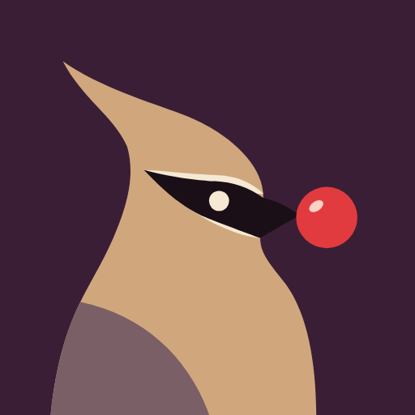

# Waxwing

The app is called **Waxwing**. Cedar waxwings line up on a branch and pass a single berry beak to
beak down the row — food handed along a family line, which is what the app does with recipes and
the week's shopping list. It replaces the working name "Meal Planner", which described the app
but could never be anyone's (a descriptive name can't be protected, and it no longer fits: recipes
and the grocery list are the heart of it now, with planning and the cupboard optional).

- **App Store name:** `Waxwing` (or `Waxwing: Family Recipes` if the listing wants keywords)
- **Subtitle:** `Family recipes & grocery list`
- **Home-screen label:** `Waxwing`
- **One-line explainer** (About, App Store description): *A waxwing is the bird that passes a berry
  down the line — that's this app, for your family's recipes and shopping.*

## The family: one bird per app

Every app gets its own name, and every name is a real bird whose real habit is that app's job. The
theme is never spelled out in a product name — line the apps up and it shows, the way macOS releases
are all California places. Shorebirds are kept for the beach-house apps.

| App | Name | Why |
| --- | --- | --- |
| Recipes & groceries (this one) | **Waxwing** | Passes berries down the row: shared food |
| Stock league (friends and AIs on the real market) | **Rook** | The cleverest corvid, loud trading-floor colonies, and the chess piece people play against machines |
| Personal finance | **Nuthatch** | Tucks seeds into bark all autumn so there is food in winter |
| Beach-house wall dashboard | **Curlew** | Works the tide line — what the dashboard watches |

**Rules** (so the set stays a set):
1. A real bird, chosen for what it *does*, not just how it looks.
2. Shorebirds (Curlew, Godwit, Plover, Turnstone, Sanderling…) only for the beach-house apps.
3. Never a bird whose name is already a big app or brand in the same category, and never a famous
   one (Robin, Finch, Wren, Lark, Swift, Sparrow, Starling, Kingfisher, Merlin, Raven, Magpie are
   all crowded).
4. Name products, never features.

**Reserve list** (screened lightly, re-check before use): Siskin, Linnet, Godwit (trips — it flies
11,000 km non-stop), Dipper (fitness — walks underwater), Nightjar (sleep), Bowerbird (photos and
collections), Weaver, Lyrebird, Honeyguide, Turnstone, Brambling.

Rook carries one caution: "to rook" means to swindle. The chess meaning wins for most people and
the league is paper money, but keep investment-advice wording well away from it. An unscreened
fallback is Skua (the seabird that chases others for their catch).

## The icon

A cedar waxwing, head and shoulders, facing right, holding one wax-red berry, on deep aubergine.

| | |
| --- | --- |
| Tile | `#3A1E36` aubergine |
| Head, crest, breast | `#D0A77C` fawn |
| Folded wing | `#7A5F66` plum-grey |
| Mask and beak | `#1A0F17` |
| Mask edges, eye | `#F5E9D3` cream |
| Berry | `#E23B3F`, highlight `#FBD2C4` |

Why it looks like this: about 40% of food-app icons are red/orange, a quarter lime green and most
of the rest teal, nearly all of them a white fork, chef's hat, pot, whisk or vegetable on flat
colour. None use aubergine, and none is a creature. The crest and bandit mask make it a waxwing,
not a generic bird (and nothing like the Twitter/Bluesky bird — no sky blue, no flying pose).

**The family system:** every sibling is the same construction — one bird, head and shoulders, the
eye in the same place, a few flat shapes, on its own deep tile, holding or beside one small round
"token" that is the app's job: Rook a stone, Nuthatch a seed, Curlew a wave line under its bill.

Source art lives in `web/scripts/brand/` (`app-icon.svg`, `glyph.svg`); `node web/scripts/brand/render-icons.mjs`
regenerates every PNG (iPhone 1024, web 512/192/180) with headless Edge or Chrome, and checks
they are opaque RGB (the App Store rejects an icon with alpha; if a browser ever writes one, it is
dropped with ffmpeg when installed, or by the script itself). After changing the art, bump the
`?v=` on the icon links in `web/index.html` and `web/public/manifest.webmanifest`;
`web/public/favicon.svg` is a copy of `app-icon.svg`.

**The mark inside the apps** is `glyph.svg`: the same bird and berry in one colour, the eye a
hole in the mask. It sits on the theme's accent tile on the sign-in screen and the share sheet
(web: `<Icon name="waxwing">`; iPhone: `AppGlyph.imageset`, in the app's asset catalog and the
share extension's own). The chef's hat stays as the placeholder for a recipe with no photo.

## Checks done (October 2026)

- **App Store (US/UK) and Google Play:** the only "Waxwing" is *Waxwing Remote*, a utility for a
  hi-fi preamp. Not in a list of ~1,970 recipe, meal-planning, grocery and pantry apps.
- **US trademarks:** WAXWING Reg. 7367520 (Parks Audio, Class 9, audio equipment) — unrelated goods.
  Nothing in Classes 29/30/35/42/43, nothing found on the UK/EU registers. Local common-law uses:
  Waxwing Bakery (Maine), Wax Wings Brewing (Kalamazoo).
- **Domains:** waxwing.com/.app are taken (parked). `getwaxwing.app`, `waxwing.family` and
  `waxwing.kitchen` were free on 16 Oct 2026. The app keeps working at meals.gehan.cloud;
  `waxwing.gehan.cloud` can be added as a second hostname in the Cloudflare tunnel.

This is a screening, not legal advice. Before filing a trademark, get a proper clearance search
(narrowly: recipe-management and shared shopping-list software, Classes 9 and 42).

## Still to do by hand

- App Store Connect → App Information → Name: "Gehan Meal Planner" → "Waxwing" (30 characters
  max, must be unique on the store — reserve it soon).
- iPhones that added the web app to their home screen keep the old icon and the label "Meals"
  until it is removed and added again; iOS never refreshes a web clip.
- Nothing internal changes: the bundle id `cloud.gehan.mealplanner`, the Keychain service, the
  `mealplanner` URL scheme, the Docker project and database names and the domain all stay, because
  renaming any of them would sign people out, orphan data or break links.
